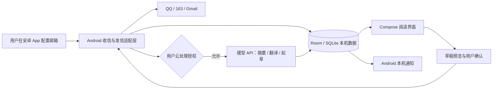

# v0.5：阅读体验验收与 Android 路线

日期：2026-10-13。当前交付的是 Windows 本机网页工作台 v0.5，不是 APK。用户已反馈 v0.4 验收未发现问题；本版集中改进使用体验。

## 怎样看到新版

关闭之前运行 MailPilot 的窗口，再双击项目根目录 `Start-MailPilot.cmd`。浏览器刷新不能让旧 Python 进程加载新版代码。个人配置、凭据与邮件数据库继续使用原有位置。

## 本次验收（不需要重新申请密钥）

1. **扫读邮件**：列表显示主题、发件地址、实际收件邮箱与两行摘要。长摘要只是视觉收起，打开阅读页仍能看到完整摘要、要点与待办。邮箱连接/推送状态和模型用量可以展开，连接故障会自动展开状态。
2. **搜索后阅读**：搜索一个主题或选择邮箱，打开邮件，再点“返回邮件列表”；应回到原搜索、邮箱筛选和页码。
3. **外文阅读**：进入英文/日文邮件，通过“重点摘要 / 中文译文 / 邮件原文 / 来源与附件”跳转。全文译文、原文与翻译完整性提示仍保留；原文不会因为列表摘要缩短而被删除。
4. **设置**：我的邮箱保持展开；模型、微信推送、收件与隐私、智能回复偏好按需展开。新增邮箱默认收起，没有邮箱时展开。修改后统一点“保存并应用配置”，折叠不会取消该组设置。
5. **输入错误恢复**：故意把收件间隔改为 0 后保存。应明确提示错误并展开设置；已填写的普通文字、选项、开关仍保留。新输入的授权码/API Key 不回显，请重新填写；没有成功保存前原配置不变。
6. **回复**：阅读页点“回复这封邮件”，检查起草、保存预览和发送确认步骤仍清楚。要测试真实发送，请继续使用你自己控制的测试邮箱，确认收件地址后发送。
7. **窄屏**：缩窄电脑浏览器到约 390 像素，或用浏览器设备预览。应出现四个底部导航；附件筛选仍在列表上方。主题和邮箱地址换行，阅读不用横向拖动，设置保存按钮在底部导航上方。320 像素也已检查。

当前服务仅监听本机。手机访问自己的 `127.0.0.1` 不会连接电脑；窄屏适配不等于远程访问，也不等于已发布安卓 App。

## 第一版功能到哪里算完整

基础闭环已经包含：多邮箱新邮件收集 → 清洗与隐私判断 → 中文摘要 / 外文全文翻译 → 本机阅读和搜索 → 可选微信推送 → 手写或智能回复草稿 → 用户核对后发送。接下来优先让这条链路可靠、容易配置、容易阅读。

下一轮建议先做 **Windows 安装与运行体验**：安装包、启动/退出状态、避免重复启动、诊断入口。之后再做可选的 **PDF/文本附件本机提取**，增加大小/类型限制和单封授权；OCR/视觉模型分开控制，默认关闭。最后发展跨邮件检索助手，用有引用的答案验证搜索质量，再决定是否需要向量 RAG。没有检索评估之前不增加 Redis 或向量服务。

## 安卓界面怎么做

技术选择：**Kotlin + Jetpack Compose + Material 3，Room 保存本机数据，WorkManager 安排可延迟的收件任务**。这是后续原生安卓版设计，当前没有增加这些依赖。选择原生方案是为了能直接处理 Android 的生命周期、通知权限、安全凭据与后台限制。它需要 Android 独立的收信/发信适配层；Python 业务规则和测试样本可复用，源码不能直接替换为 Kotlin。

| 页面 | 手机体验 | 大屏体验 |
| --- | --- | --- |
| 邮件 | 搜索 + 邮箱筛选 + 简短卡片；主题、来源、重点 | 列表与阅读可采用左右两栏 |
| 阅读 | 摘要优先，原文/译文入口明确；回复只有一个主要入口 | 正文宽栏，来源与附件窄栏 |
| 待办 | 按邮件聚合明确行动，点击回到原邮件 | 同一信息结构 |
| 设置 | 邮箱、阅读、通知、隐私、回复分组；首次配置逐步引导 | 不堆积全部 API 参数 |
| 回复 | 草稿 → 全文预览 → 明确确认发送 | 同样的确认流程 |

图标必须配文字；颜色不能单独表示状态；重要按钮目标至少 48dp；支持系统字体放大、TalkBack 和深浅主题。手机版不会缩小桌面菜单，而是按屏幕大小重新组织阅读任务。[官方自适应界面指南](https://developer.android.com/develop/ui/compose/build-adaptive-apps)。

## 不租服务器时，安卓如何收信

可以独立运行在用户手机，不租自有后端；邮箱和模型仍是外部服务，模型可能有费用。Android 通知直接来自本机收信结果，WxPusher 可选保留作另一条通知通道，不把微信消息当作数据库再转进 App。

后台及时性要单独验证。WorkManager 的周期任务最短为 15 分钟，实际执行还受系统调度影响，不能当成秒级实时收信；前台打开时可以主动同步。[官方周期任务说明](https://developer.android.com/develop/background-work/background-tasks/persistent/getting-started/define-work)。持续连接或前台服务要按系统规则评估电量和常驻通知，不能宣称 App 被系统关闭后仍永久实时在线。

**当前决策**：先完成本机产品体验，再做独立安卓原型验证真实设备后台行为。只有明确需要多设备同步或稳定集中收信时，再引入常在线后端；后端访问 MySQL，客户端通过 HTTPS 同步，本机继续保留 SQLite。没有服务器时不承诺电脑与手机数据自动共享。

## 本版验证范围

使用合成邮件验证桌面、390px 与 320px 排版，点击阅读跳转、设置展开/折叠、错误恢复和手动回复入口；离线回归覆盖原有链路以及筛选返回与错误表单保留。开发验证没有调用真实模型、发送真实邮件、修改你的个人配置或邮件数据。Android 真机、软键盘遮挡、TalkBack 与安装包暂未验证。
