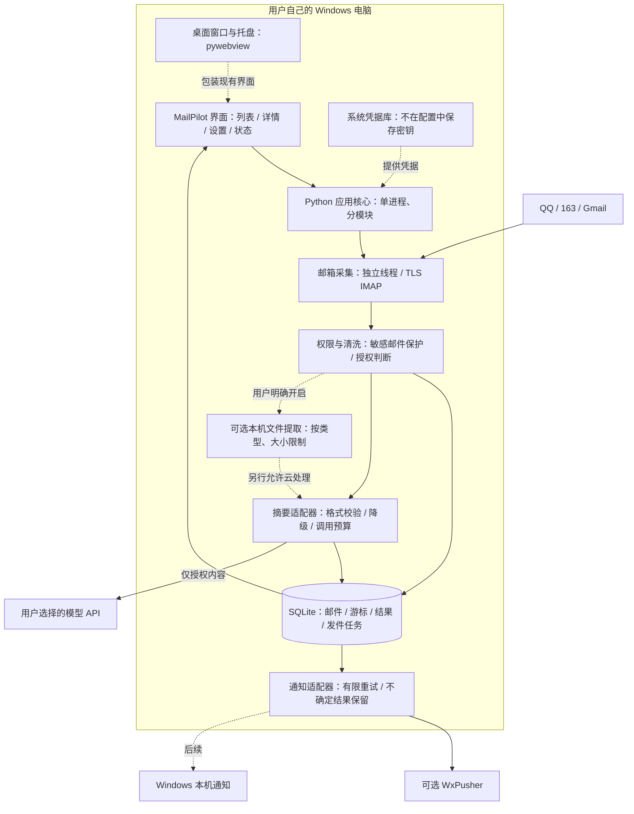
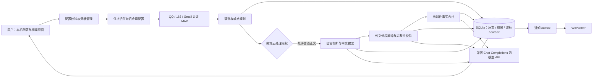
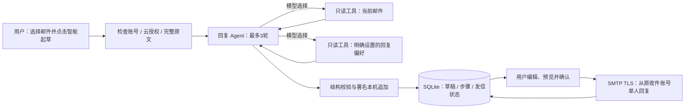
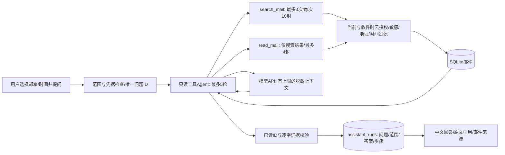

# MailPilot 系统架构与产品规划

更新：2026-10-12。目标是可下载、由用户自行配置的个人邮件助理。**先交付 Windows 桌面产品，之后扩展独立安卓版；本地优先，不要求开发者租服务器。** 本文区分当前实现和规划，不把未实现功能写成已交付。

## 1. 成品如何使用

用户安装并打开 MailPilot → 界面添加邮箱 → 配置自己的模型/通知渠道 → 查看统一邮件工作台。

主要页面只保留四类：

| 页面 | 用户获得什么 |
| --- | --- |
| 邮件工作台 | 多邮箱合并列表、搜索筛选、来源、中文摘要、下一步行动 |
| 邮件详情 | 发件人、To/Cc、实际收件账号、摘要、正文、附件处理结果 |
| 账号与偏好 | 添加邮箱、连接测试、摘要风格、费用限制、解析与隐私开关 |
| 运行状态 | 同步进度、失败原因、通知状态、模型调用统计 |

默认仅处理连接成功后的新邮件；以后提供明确选择时间范围的历史导入，避免首次运行批量产生费用。应用内邮件记录是主入口，桌面通知和 WxPusher 是可选提醒出口。

## 2. 架构图：桌面版目标

下图虚线部分尚未实现；当前已有本机网页工作台、Python 核心、SQLite、正文摘要及 WxPusher。

本机 HTTP 服务只监听 `127.0.0.1`，是同一设备里连接界面与核心的入口，**不是需要租赁的互联网服务器**。不对外开放收件控制接口，不拆微服务；桌面壳和业务核心共用一个应用生命周期。

## 3. 技术选型

| 层 | 选择 | 理由与交付状态 |
| --- | --- | --- |
| Windows 核心 | Python 3.11+ | 当前已实现；邮件、文件处理迭代快，沿用已验证代码 |
| Windows 界面 | HTML/CSS，按需少量 JavaScript | 当前响应式本机工作台；不先引入前端构建工具 |
| 桌面窗口 | pywebview + WebView2 | 规划：复用界面并包装为桌面窗口；需验证运行时和分发安装体验 |
| Windows 打包 | PyInstaller | 规划：生成可下载的桌面程序，用户无需自行装 Python |
| 本地存储与任务 | SQLite + WAL + 持久化 outbox | 当前已实现；邮件、收件进度与通知任务可事务保存，无独立数据库服务 |
| 收件 | 标准库 IMAP/TLS；Gmail OAuth 后续 | 当前 QQ/163 授权码、Gmail 应用密码；公开分发前完善授权流程 |
| 模型 | HTTPS chat/completions 适配器 | 当前已实现；用户提供自己的 API Key，不把开发者共享密钥装进客户端 |
| 凭据 | Windows 系统凭据库 | 规划；当前仅隐藏输入并保存在进程内存，不宣称已经安全持久化 |
| 文件提取 | 按类型的本机解析器 | 规划，文本 → 文档 → OCR 分阶段；每次只增加该阶段需要的依赖 |
| Android | Kotlin + Jetpack Compose + Room | 规划：原生界面、本机数据库与系统后台任务；复用数据格式和业务规则，不强行运行 Windows Python 程序 |

选型依据：[pywebview 安装与 Windows 运行时](https://pywebview.flowrl.com/guide/installation.html)、[打包说明](https://pywebview.flowrl.com/guide/freezing.html)、[Android Compose](https://developer.android.com/develop/ui/compose/documentation)、[Android Room](https://developer.android.com/training/data-storage/room)。这些是后续实现路线，尚未生成安装包。

## 4. 邮件处理的五步

1. 只读采集：用账号、文件夹、UIDVALIDITY、UID 定位邮件；首次建立基线。
2. 持久入库：保存清洗信息并推进游标，事务失败时不能跳过邮件。
3. 按权限处理：保护验证/登录邮件；正文云摘要、文件提取与文件云处理分别判断。
4. 生成摘要：保留金额、日期和明确行动；校验结构，不执行邮件中的指令。失败时仍保留邮件并显示降级提醒。
5. 通知：将结果放入持久化 outbox，发送成功、明确失败和结果不确定分别处理。

附件失败不能阻断正文摘要；通知失败不能使已收邮件丢失。来源字段来自程序解析，不能由模型改写。摘要风格当前可配置，但质量改进需要用同一批合成/授权样例比较事实遗漏、日期金额准确率及待办误判，不能仅凭换了提示词宣称质量已提升。

## 5. 图片和文件的权限设计

当前 v0.2 **仅显示附件名称，不解析附件，不发送附件内容给模型**。

后续每个邮箱独立设置：`本机附件解析`、`允许解析的类型`、`图片 OCR`、`允许提取内容参与云摘要`。全部默认关闭；开启云处理也必须满足该邮箱的云摘要授权。

允许的解析类型采用白名单；限制单文件大小、文件数、总提取字符数和处理时间。不运行宏、不执行文件、不自动访问外部链接。扫描 PDF 的 OCR 与有文本 PDF 的提取单独处理，避免无意增加模型费用。原附件不自动永久保存，提取文本的保存/清理策略在实现时明确告知用户。关闭开关不等于撤回已发送的数据，也不等于自动删除旧记录。

## 6. WxPusher 与自己的 App 怎么配合

本地结果同时进入“应用内列表”和“可选通知通道”。无需先发 WxPusher 再倒回来保存。

WxPusher 的消息 `url` 支持手机端自定义 URL Scheme，后续可以实现“点击通知 → 打开 MailPilot 对应详情”。**这只是跳转，不是向自己的 App 自动同步历史，也不是把 WxPusher 的通知变成自己的原生通知。** 当前代码尚未发送该字段，也没有注册 App 跳转协议。[官方接口字段](https://wxpusher.zjiecode.com/docs/api-reference.html)

通知链接只放定位信息，不放密钥或完整敏感正文。安卓端必须已经有对应记录，或有独立获取记录的路径，才能展示详情。电脑上的 SQLite 不会因通知跳转就出现在手机上。

## 7. 不租服务器的边界

| 使用方式 | 是否必须租服务器 | 代价/边界 |
| --- | --- | --- |
| Windows 应用自己收件、总结、展示 | 不需要 | 电脑需要运行且联网；云模型仍可能收费 |
| Windows 用 WxPusher 提醒手机 | 不需要自租 | 依赖第三方推送服务；电脑离线时不处理新邮件 |
| 安卓应用自己连接邮箱、保存记录 | 不需要 | 后台同步受系统节电约束，不能保证关闭/休眠时每分钟执行 |
| 各设备独立接入同一邮箱 | 不需要 | 摘要和待办状态不自动一致，可能重复调用模型；需单独设计历史获取 |
| 跨设备共享同一摘要与状态、统一托管密钥、设备全关仍持续处理 | 需要持续在线的服务承担这些职责 | 可另做可选同步/托管版；不属于当前本地版承诺 |

Android 后台网络和任务会受 Doze/App Standby 延迟，不能把桌面上的 60 秒轮询直接搬过去并承诺同样实时。[Android 官方限制](https://developer.android.com/training/monitoring-device-state/doze-standby)

“不租服务器”不等于完全离线或完全零费用：邮箱、云模型和 WxPusher 仍是外部服务。纯本机模型以后可作为可选适配器，需要用户承担硬件和部署成本。

## 8. 实施顺序与优化原则

| 阶段 | 交付内容 | 完成状态 |
| --- | --- | --- |
| v0.1 | 收件 → 中文摘要 → 来源明确的 WxPusher 通知 | 已交付，用户反馈第 6 节测试效果良好 |
| v0.2 | 工作台、搜索分页、待办筛选、隐私与摘要偏好设置、版本/性能记录 | 本轮交付；真实体验验收单独记录 |
| 下一阶段 | Windows 桌面壳、图形化账号配置、系统凭据库、托盘/本机通知与安装包 | 未开始，不与 Android 同时铺开 |
| 文件阶段 | 按默认关闭的权限策略逐步加入文本/PDF/Word与图片 OCR，验证费用和摘要质量 | 未开始 |
| Android 阶段 | 独立收件客户端、记录列表、本机通知、休眠恢复；再验证 WxPusher 跳转 | 未开始 |

当前不需要 Redis、消息队列服务、Docker 或多租户后端。以后先测瓶颈：查询慢先查索引、分页和本地全文检索；模型慢先测网络/模型耗时、重复调用和并发限制。只有重复热点查询或多进程共享确有需求时才评估 Redis，并记录命中率、失效规则、内存、故障降级与部署成本。不能仅为简历增加组件。

历史变更、测试和当前性能数字统一保存在 [版本演进与技术复盘](版本演进与技术复盘.md)，避免每份文档重复维护结论。
# v0.3 当前架构与 Agent 学习路线补充

当前已实现 Python 标准库本机服务、SQLite 邮件与任务持久化、Windows 凭据管理器、浏览器配置页面；不需要租服务器。双击启动入口自动打开页面，但尚未打包为独立安装程序。

密钥在当前进程使用，用户可选保存到 Windows 当前用户凭据库。模型密钥按项目路径与 API 地址隔离，邮箱凭据按服务器和地址隔离。API 与 WxPusher 是外部服务；“不租自有服务器”不等于“不联网”或“模型免费”。邮件原始 MIME 不落盘，附件仍不解析。

## 从阅读工作流发展到真正的 Agent

用户希望通过开发学习 Agent 技术，这作为后续明确目标。当前是**受控的模型工作流**，处理顺序由程序决定；不能仅因为调用了 LLM 就写成自主 Agent，也不能把 RAG 当作分类误判的修复工具。

1. **先稳定阅读质量**：本版明确原文、全文翻译、摘要三份结果；校验模型结构、输出结束状态、调用次数与隐私授权。测试邮件主题不能代替正文理解。
2. **增加可查询工具**：先提供按邮箱/日期/关键词搜索、读取指定邮件、列出待办等只读工具，每次限制返回量。禁止模型自行执行脚本、打开邮件链接、发送邮件或扩展授权。
3. **增加工具调用 Agent**：用户问“本周客户有哪些待办”，模型选择搜索和读取工具，程序验证参数、邮箱权限与最大调用轮次，最后回答并引用实际邮件。记录工具名、参数摘要、耗时、调用成本和结果状态，不记录或展示模型隐含思维过程。
4. **有检索需求再引入 RAG**：先用 SQLite 全文检索验证基线；只有跨语言或表达差异导致关键词召回不足时，再评估向量检索。流程是检索候选邮件 → 按权限过滤 → 取相关正文 → 生成有引用的回答。索引必须能删除、更新、随授权变化失效。
5. **可选附件理解**：本机提取、云处理分别授权，默认关闭；带解析超时、体积/类型限制和恶意文档处理。将图片或文件文本作为检索数据，不能将其内容当作 Agent 指令。

工具调用与 RAG 阶段需建立固定评估集，分别测事实覆盖、引用准确、召回率、无依据回答、耗时和调用费用，再决定是否引入编排框架或缓存。当前不加 Redis，不增加独立向量服务器，不让模型自动发邮件。本版没有上线这些未来能力。

未来可准确定位为“本地邮件阅读与检索 Agent”：有工具选择、受限执行、来源引用与评估证据后，才将相应能力写进简历。

# v0.4 当前增量：受限回复 Agent 与本地数据库

以下 v0.3 部分保留为历史设计，本节更新当前已实现能力。阅读/摘要/翻译仍是确定顺序工作流；新增用户触发的回复 Agent，模型选择两个只读工具，发信完全由用户预览后确认。

模型工具列表中没有 SMTP，也没有自由查询其他邮箱的工具。原文与偏好才在用户点击时按授权交给模型；署名本机追加。当前习惯是用户设置，未自动训练历史画像。检索/RAG、附件理解和跨设备同步仍是后续能力。

## 数据库部署决策

当前使用 SQLite，默认项目 `data/mailpilot.sqlite3`。它是本地文件数据库，用户不安装额外服务，不租数据库资源。客户端采集、阅读、草稿与手动回复持续采用这一布局。

| 使用形态 | 数据库位置 | 需要额外服务器吗 |
| --- | --- | --- |
| 当前 Windows 单机版 | 用户电脑 SQLite 文件 | 不需要 |
| 自己学习 MySQL 的开发环境 | 自己电脑上的 MySQL 服务 | 不需要租赁，但需安装/启动 |
| 未来账号登录、多设备或团队共享 | 后端服务器私有网络中的 MySQL；客户端保留 SQLite | 需要持续在线后端，可租资源或自有设备 |

未来共享服务的客户端通过 HTTPS 访问后端，后端才连接 MySQL；不让手机/桌面直接暴露数据库密码或公网访问数据库。SQLite 与 MySQL不是开关互换，先保持 Store 边界，需求明确时实现方言、事务、索引、迁移与同步协议。

# v0.5 当前增量：阅读界面与客户端路线

当前核心仍为 Python 本机服务 + SQLite；页面调整不引入 Redis/MySQL，也不改变发送确认和云处理授权。新增样式模块、阅读锚点、筛选上下文、折叠设置与配置错误恢复。手机底部导航只是响应式布局，不扩大本机 HTTP 的监听范围。

原生安卓规划使用 Kotlin + Jetpack Compose / Material 3 + Room / SQLite + WorkManager。UI 复用的是信息结构与交互规则，Android 的邮箱连接、凭据、通知、后台生命周期需独立适配；API 摘要协议和测试样本可以复用。当前没有 REST 同步协议、安卓收信实现或 APK。

按顺序推进：Windows 安装与运行体验 → 默认关闭的本机附件提取 → 有来源引用的跨邮件检索助手 → 基于检索评估决定 RAG → 安卓真机后台原型。多端同步作为明确需求后再建设 HTTPS 后端与 MySQL。详见 [v0.5 界面验收与安卓路线](v0.5-界面验收与安卓路线.md)。

# v0.6 当前增量：减少重复信息

首页收敛为搜索/邮箱筛选/邮件列表，诊断默认收起；异常仍有可见提示。阅读单列展示摘要、译文与原文，To/Cc与投递状态折叠保留。设置账号参数、字段帮助分开展开。没有改变权限、端口监听、模型协议、Agent工具、数据库或SMTP确认流程。

下一智能体功能优先做跨邮件只读助手：受限搜索 → 指定邮件读取 → 权限与云授权校验 → 有引用回答 → 召回/引用/费用评估 → 必要时 RAG。当前已有受限回复Agent；本版没有增加跨邮件工具或RAG。用户最新反馈使本轮优先界面精简，安装与运行管理仍待完成。

# v0.7 当前增量：跨邮件检索助手

只读问题锁与配置短锁分离，慢模型请求不阻止GUI保存撤销。模型请求前后重新检查当前配置，已发出请求无法撤回。原生表单POST后跳结果GET，浏览器脚本只处理加载反馈并由随机nonce许可；没有API后台任务队列、实时阶段推送、自动发信或对话记忆。

关键词检索＋上下文生成构成检索增强的基础形态，尚无向量embedding。保留SQLite与标准库选型，新增助手结果表，之后建立固定检索评估再决定向量方案。详情见 [v0.7验收](v0.7-加载反馈与智能助手验收.md)。
