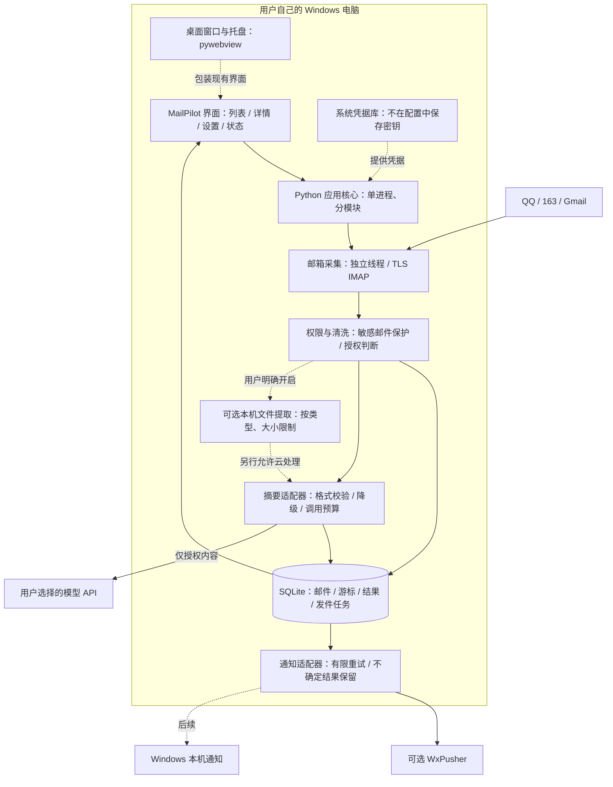

# MailPilot 系统架构与产品规划

更新：2026-10-12。目标是可下载、由用户自行配置的个人邮件助理。**先交付 Windows 桌面产品，之后扩展独立安卓版；本地优先，不要求开发者租服务器。** 本文区分当前实现和规划，不把未实现功能写成已交付。

## 1. 成品如何使用

用户安装并打开 MailPilot → 界面添加邮箱 → 配置自己的模型/通知渠道 → 查看统一邮件工作台。

主要页面只保留四类：

| 页面 | 用户获得什么 |
| --- | --- |
| 邮件工作台 | 多邮箱合并列表、搜索筛选、来源、中文摘要、下一步行动 |
| 邮件详情 | 发件人、To/Cc、实际收件账号、摘要、正文、附件处理结果 |
| 账号与偏好 | 添加邮箱、连接测试、摘要风格、费用限制、解析与隐私开关 |
| 运行状态 | 同步进度、失败原因、通知状态、模型调用统计 |

默认仅处理连接成功后的新邮件；以后提供明确选择时间范围的历史导入，避免首次运行批量产生费用。应用内邮件记录是主入口，桌面通知和 WxPusher 是可选提醒出口。

## 2. 架构图：桌面版目标

下图虚线部分尚未实现；当前已有本机网页工作台、Python 核心、SQLite、正文摘要及 WxPusher。

本机 HTTP 服务只监听 `127.0.0.1`，是同一设备里连接界面与核心的入口，**不是需要租赁的互联网服务器**。不对外开放收件控制接口，不拆微服务；桌面壳和业务核心共用一个应用生命周期。

## 3. 技术选型

| 层 | 选择 | 理由与交付状态 |
| --- | --- | --- |
| Windows 核心 | Python 3.11+ | 当前已实现；邮件、文件处理迭代快，沿用已验证代码 |
| Windows 界面 | HTML/CSS，按需少量 JavaScript | 当前响应式本机工作台；不先引入前端构建工具 |
| 桌面窗口 | pywebview + WebView2 | 规划：复用界面并包装为桌面窗口；需验证运行时和分发安装体验 |
| Windows 打包 | PyInstaller | 规划：生成可下载的桌面程序，用户无需自行装 Python |
| 本地存储与任务 | SQLite + WAL + 持久化 outbox | 当前已实现；邮件、收件进度与通知任务可事务保存，无独立数据库服务 |
| 收件 | 标准库 IMAP/TLS；Gmail OAuth 后续 | 当前 QQ/163 授权码、Gmail 应用密码；公开分发前完善授权流程 |
| 模型 | HTTPS chat/completions 适配器 | 当前已实现；用户提供自己的 API Key，不把开发者共享密钥装进客户端 |
| 凭据 | Windows 系统凭据库 | 规划；当前仅隐藏输入并保存在进程内存，不宣称已经安全持久化 |
| 文件提取 | 按类型的本机解析器 | 规划，文本 → 文档 → OCR 分阶段；每次只增加该阶段需要的依赖 |
| Android | Kotlin + Jetpack Compose + Room | 规划：原生界面、本机数据库与系统后台任务；复用数据格式和业务规则，不强行运行 Windows Python 程序 |

选型依据：[pywebview 安装与 Windows 运行时](https://pywebview.flowrl.com/guide/installation.html)、[打包说明](https://pywebview.flowrl.com/guide/freezing.html)、[Android Compose](https://developer.android.com/develop/ui/compose/documentation)、[Android Room](https://developer.android.com/training/data-storage/room)。这些是后续实现路线，尚未生成安装包。

## 4. 邮件处理的五步

1. 只读采集：用账号、文件夹、UIDVALIDITY、UID 定位邮件；首次建立基线。
2. 持久入库：保存清洗信息并推进游标，事务失败时不能跳过邮件。
3. 按权限处理：保护验证/登录邮件；正文云摘要、文件提取与文件云处理分别判断。
4. 生成摘要：保留金额、日期和明确行动；校验结构，不执行邮件中的指令。失败时仍保留邮件并显示降级提醒。
5. 通知：将结果放入持久化 outbox，发送成功、明确失败和结果不确定分别处理。

附件失败不能阻断正文摘要；通知失败不能使已收邮件丢失。来源字段来自程序解析，不能由模型改写。摘要风格当前可配置，但质量改进需要用同一批合成/授权样例比较事实遗漏、日期金额准确率及待办误判，不能仅凭换了提示词宣称质量已提升。

## 5. 图片和文件的权限设计

当前 v0.2 **仅显示附件名称，不解析附件，不发送附件内容给模型**。

后续每个邮箱独立设置：`本机附件解析`、`允许解析的类型`、`图片 OCR`、`允许提取内容参与云摘要`。全部默认关闭；开启云处理也必须满足该邮箱的云摘要授权。

允许的解析类型采用白名单；限制单文件大小、文件数、总提取字符数和处理时间。不运行宏、不执行文件、不自动访问外部链接。扫描 PDF 的 OCR 与有文本 PDF 的提取单独处理，避免无意增加模型费用。原附件不自动永久保存，提取文本的保存/清理策略在实现时明确告知用户。关闭开关不等于撤回已发送的数据，也不等于自动删除旧记录。

## 6. WxPusher 与自己的 App 怎么配合

本地结果同时进入“应用内列表”和“可选通知通道”。无需先发 WxPusher 再倒回来保存。

WxPusher 的消息 `url` 支持手机端自定义 URL Scheme，后续可以实现“点击通知 → 打开 MailPilot 对应详情”。**这只是跳转，不是向自己的 App 自动同步历史，也不是把 WxPusher 的通知变成自己的原生通知。** 当前代码尚未发送该字段，也没有注册 App 跳转协议。[官方接口字段](https://wxpusher.zjiecode.com/docs/api-reference.html)

通知链接只放定位信息，不放密钥或完整敏感正文。安卓端必须已经有对应记录，或有独立获取记录的路径，才能展示详情。电脑上的 SQLite 不会因通知跳转就出现在手机上。

## 7. 不租服务器的边界

| 使用方式 | 是否必须租服务器 | 代价/边界 |
| --- | --- | --- |
| Windows 应用自己收件、总结、展示 | 不需要 | 电脑需要运行且联网；云模型仍可能收费 |
| Windows 用 WxPusher 提醒手机 | 不需要自租 | 依赖第三方推送服务；电脑离线时不处理新邮件 |
| 安卓应用自己连接邮箱、保存记录 | 不需要 | 后台同步受系统节电约束，不能保证关闭/休眠时每分钟执行 |
| 各设备独立接入同一邮箱 | 不需要 | 摘要和待办状态不自动一致，可能重复调用模型；需单独设计历史获取 |
| 跨设备共享同一摘要与状态、统一托管密钥、设备全关仍持续处理 | 需要持续在线的服务承担这些职责 | 可另做可选同步/托管版；不属于当前本地版承诺 |

Android 后台网络和任务会受 Doze/App Standby 延迟，不能把桌面上的 60 秒轮询直接搬过去并承诺同样实时。[Android 官方限制](https://developer.android.com/training/monitoring-device-state/doze-standby)

“不租服务器”不等于完全离线或完全零费用：邮箱、云模型和 WxPusher 仍是外部服务。纯本机模型以后可作为可选适配器，需要用户承担硬件和部署成本。

## 8. 实施顺序与优化原则

| 阶段 | 交付内容 | 完成状态 |
| --- | --- | --- |
| v0.1 | 收件 → 中文摘要 → 来源明确的 WxPusher 通知 | 已交付，用户反馈第 6 节测试效果良好 |
| v0.2 | 工作台、搜索分页、待办筛选、隐私与摘要偏好设置、版本/性能记录 | 本轮交付；真实体验验收单独记录 |
| 下一阶段 | Windows 桌面壳、图形化账号配置、系统凭据库、托盘/本机通知与安装包 | 未开始，不与 Android 同时铺开 |
| 文件阶段 | 按默认关闭的权限策略逐步加入文本/PDF/Word与图片 OCR，验证费用和摘要质量 | 未开始 |
| Android 阶段 | 独立收件客户端、记录列表、本机通知、休眠恢复；再验证 WxPusher 跳转 | 未开始 |

当前不需要 Redis、消息队列服务、Docker 或多租户后端。以后先测瓶颈：查询慢先查索引、分页和本地全文检索；模型慢先测网络/模型耗时、重复调用和并发限制。只有重复热点查询或多进程共享确有需求时才评估 Redis，并记录命中率、失效规则、内存、故障降级与部署成本。不能仅为简历增加组件。

历史变更、测试和当前性能数字统一保存在 [版本演进与技术复盘](版本演进与技术复盘.md)，避免每份文档重复维护结论。
